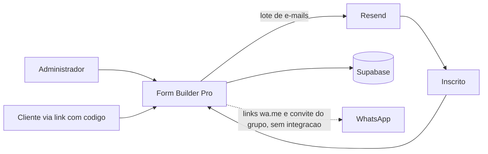
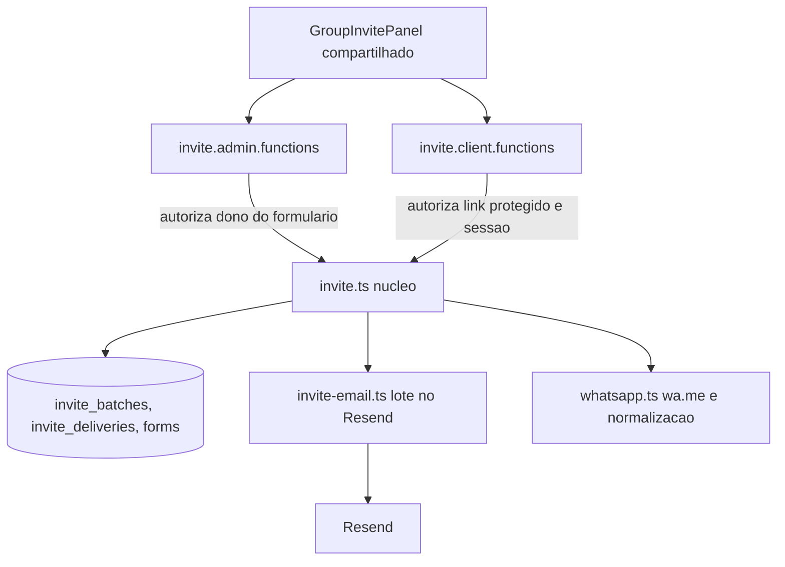
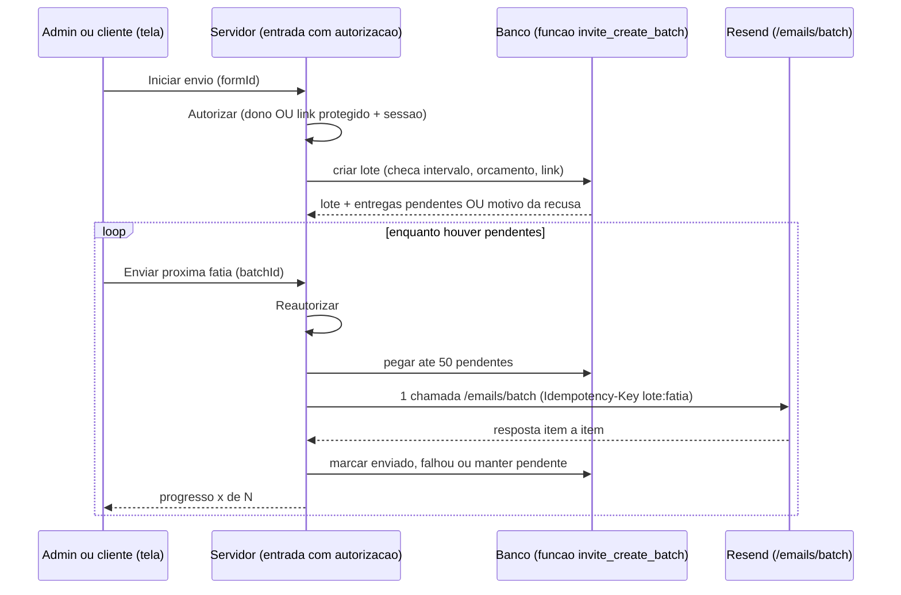

# Arquitetura — M-46 Convite em lote para o grupo do WhatsApp (Form Builder Pro)

Insumos: `prd-m46-grupo-whatsapp.md`, `ui-ux-m46.md`. Repositório medido no commit `524ac2b` (12/11/2026). Local previsto no repositório: `docs/arquitetura/architecture.md` e `docs/arquitetura/adr/`. O Form Builder Pro ainda não tinha `architecture.md`; este documento cobre apenas a M-46 e cita o que já existe no código.

## 1. Resumo e premissas

### 1.1 Conclusão em linguagem simples (leia primeiro)
- **Não vamos adicionar pessoas ao grupo pelo sistema.** O sistema entrega o convite: e-mail em lote, link na confirmação e botão de WhatsApp por pessoa (ADR-001). Custo adicional: zero, sem servidor novo.
- **O envio de e-mail em lote será feito em fatias de até 50, usando o endpoint de lote do Resend** (ADR-002). Mandar um e-mail por vez estouraria o limite do plano gratuito da Cloudflare (50 chamadas externas por requisição).
- **O ponto apertado é o limite do Resend gratuito: 100 e-mails por dia.** Convidar 57 pessoas usa mais da metade; confirmações de novas inscrições no mesmo dia usam a mesma cota. O sistema reserva 20 por dia para confirmações e envia o que couber, deixando o resto para continuar no dia seguinte (ADR-005). Se esse limite incomodar, o passo seguinte é o plano Pro do Resend (US$ 20 por mês, 50.000 por mês), conforme EV-01.
- **O cliente só dispara convites se o link dele tiver código de acesso** (ADR-004). Links antigos sem código continuam só de leitura, até você clicar "Proteger com código".
- **O que você precisa aprovar:** os cinco ADRs, e responder duas perguntas (seção 1.3): em que plano da Cloudflare o Worker está, e qual o limite diário real do Resend na sua conta.

### 1.2 Modo e porte
Modo: **novo, restrito a uma feature sobre código próprio já em produção** (não é base de terceiros, então o modo "sobre base existente" não se aplica). Porte: **enxuto**. Sinais do PRD: envio de e-mail em massa com dados pessoais (1), vários clientes usam o mesmo sistema (2, no limite). Contei como enxuto porque é um módulo pequeno, mantido por uma pessoa, sem dado sensível, financeiro ou de saúde, e sem prejuízo direto se parar. O dono pode sobrescrever.

### 1.3 Premissas e restrições
| # | Premissa | Estado |
|---|---|---|
| P1 | O Worker de produção está no plano Free da Cloudflare (50 subrequests, 10 ms de CPU) | **Não confirmada.** Projetamos para caber no Free; se for pago, há folga |
| P2 | A conta do Resend está no plano gratuito (100 por dia, 3.000 por mês) | **Não confirmada.** Página de preços do Resend sem data; conferir em Settings, Usage |
| P3 | Todo formulário com convite tem pergunta de e-mail | Do PRD, a confirmar no DP |
| P4 | Remetente e domínio de e-mail já funcionam (confirmações atuais) | Verificado no código: `EMAIL_FROM`, `RESEND_API_KEY` |
| P5 | O segredo `SHARE_SESSION_SECRET` existe em prévia e produção | Confirmado pelo dono em 12/11 |
Restrições: custo zero; sem novo serviço, fila ou servidor; stack atual (TanStack Start, Supabase, Resend, Workers).

### 1.4 O que o PRD decidiu e o destino
| Decisão no PRD | Destino | Onde |
|---|---|---|
| DP-01, DP-02, DP-03 (convite por link; e-mail em lote como canal principal) | Ratificadas, viram arquitetura | ADR-001 |
| CA-01 (não usar Groups API oficial) | Ratificada | ADR-001 |
| CA-02 (não usar bibliotecas não oficiais) | Ratificada | ADR-001 |
| CA-03 (envio em fatias, retomada) | **Refinada**: endpoint de lote do Resend, fatias de 50, Idempotency-Key | ADR-002 |
| CA-04 (persistir convites e lotes) | Ratificada, com desenho | ADR-003 |
| CA-05 (escrita via sessão do link privado) | **Emendada**: só com link protegido; link legado fica só de leitura | ADR-004 |
| RNF-04 ([definir] valores) | Definido: 10 min entre lotes por formulário e 80 por 24 h no sistema | ADR-005 |
| RNF-03 ([definir] limite do Resend) | Premissa P2 e EV-01 | seção 7 |
| RNF-07 ([definir] 60 s) | Mantido como RQ-01 com base em fatias | seção 2 |

## 2. Requisitos de qualidade (RQ-NN)
| ID | Atributo | Cenário | Medida e limite | Como medir | Base | Tática |
|---|---|---|---|---|---|---|
| RQ-01 | Desempenho dentro dos limites do Worker | Cliente toca "Enviar convite" para 57 inscritos | Cada chamada ao servidor usa no máximo 20 chamadas externas (banco e Resend) e envio completo em até 60 s | Teste com `fetch` simulado que conta chamadas; log em produção | Limite do Worker Free: documentação da Cloudflare (50 subrequests, 10 ms de CPU); 20 é margem de projeto; premissa P1 | Fatias de 50, um único POST ao Resend por fatia |
| RQ-02 | Custo | Dia de envio com 57 convites mais confirmações | Nunca ultrapassar 100 e-mails por dia no Resend gratuito: convites limitados a 80 por 24 h | Teste da função de limite; painel do Resend, Usage | Página de preços do Resend, premissa P2 | Orçamento diário em função SQL (ADR-005), retomada no dia seguinte |
| RQ-03 | Confiabilidade | Duplo toque, atualização da página ou falha no meio do envio | 0 e-mails duplicados no mesmo lote e quem já recebeu não recebe de novo sem "reenviar" | Teste de duas chamadas concorrentes e teste de retomada | Premissa de projeto | Estado por destinatário no banco; Idempotency-Key por fatia (válida por 24 h, documentação do Resend) |
| RQ-04 | Segurança e abuso | Alguém com o endereço do link do cliente, sem código, tenta enviar | 0 ações de escrita sem link protegido e sessão válida; no máximo 1 lote por formulário a cada 10 min | Teste de autorização por função e teste de intervalo | Decisão de projeto (ADR-004, ADR-005) | Funções de entrada separadas; limite atômico no banco |
| RQ-05 | Privacidade | Convite por e-mail | Cada mensagem tem exatamente 1 destinatário em `to`, sem `cc` ou `bcc`, e nenhum dado de outro inscrito | Teste que inspeciona o corpo enviado ao Resend | Requisito do PRD (RNF-02) | Construção de cada item do lote com um só destinatário |
Conflito registrado: **custo (RQ-02) contra rapidez de entrega.** Para 57 pessoas cabe no dia; formulários maiores ficam em retomada. Resolvido no ADR-005 e na EV-01.

## 3. Visão estrutural

### 3.1 Contexto

Legenda: a linha pontilhada não é uma conexão do sistema; o WhatsApp só aparece como destino de links abertos pelo usuário.

### 3.2 Componentes (dentro do Form Builder Pro)

### 3.3 Módulos e onde mora cada lógica
| Peça | Arquivo (proposto) | Regra que mora ali |
|---|---|---|
| Validação do link do grupo, mensagem padrão, vCard | `src/lib/invite.ts` (funções puras) | Sem rede, sem cookie, sem banco |
| Montagem e envio do lote no Resend | `src/lib/invite-email.ts` | Único ponto que chama `api.resend.com/emails/batch` |
| Autorização e orquestração | `src/lib/invite.functions.ts` (duas entradas: administrador e cliente) | Cookie, sessão e dono do formulário ficam aqui, nunca no núcleo |
| Limites e criação do lote | função SQL `invite_create_batch` | Intervalo, orçamento e transação atômicos |
| Telas | `src/components/GroupInvitePanel.tsx`; editor; `$slug.tsx`; `c.$token.tsx` | Só apresentação; sem regra |
Reaproveitados sem mudar: `parseBrazilMobile`, `whatsappUrl`, `firstNameOf` (`src/lib/whatsapp.ts`), `escapeHtml` e `isSafeRecipient` (`src/lib/confirmation-email.ts`), `verifyShareSession`, `shareCookieName`, `parseCookieHeader` (`src/lib/share.ts`).

### 3.4 Dono de cada dado
| Dado | Fonte da verdade | Observação |
|---|---|---|
| Link do grupo | `forms.whatsapp_group_link` | Os e-mails já enviados mantêm o link antigo (P-04 do UI/UX) |
| Telefone e e-mail do inscrito | `responses.answers` | Nunca copiados para as tabelas novas |
| Quem foi convidado e quando | `invite_deliveries` | Só ids e estado |
| Totais e autoria do lote | `invite_batches` | Autoria: administrador (usuário) ou "cliente via link" |

## 4. Regras e fronteiras

### 4.1 Regras de arquitetura (ARQ-NN)
| ID | Regra | Por quê | Como verificar | Hoje (12/11/2026) | ADR |
|---|---|---|---|---|---|
| ARQ-01 | Nenhuma biblioteca nem API do WhatsApp no projeto | O sistema só gera links | `grep -inE "baileys\|whatsapp-web\|wppconnect\|venom-bot\|@whiskeysockets" package.json \| wc -l` deve dar 0 | passa (0) | ADR-001 |
| ARQ-02 | Tabelas novas só são acessíveis por service role | Evita leitura direta pelo navegador | Migração contém `REVOKE ALL ... FROM anon, authenticated` e RLS ligado; teste de banco | verificável a partir da migração da M-46 | ADR-003 |
| ARQ-03 | Toda função de escrita do cliente exige `share_code_hash` preenchido e sessão válida | Link legado aberto não pode disparar e-mail | Teste: uma chamada por função com link legado e com sessão ausente, esperando recusa | verificável a partir da tarefa de funções | ADR-004 |
| ARQ-04 | `src/lib/invite.ts` e `invite-email.ts` não importam `getRequest` nem leem cookie | Autorização fica numa camada só | `grep -n "getRequest\|cookie" src/lib/invite.ts src/lib/invite-email.ts` não retorna nada | verificável a partir da tarefa | ADR-004 |
| ARQ-05 | Intervalo e orçamento se decidem na função SQL, nunca em "ler e depois gravar" no código | Evita corrida (lição da T-44) | Teste de duas chamadas simultâneas: só uma cria lote | verificável a partir da tarefa | ADR-005 |
| ARQ-06 | Envio de convite só pelo endpoint `/emails/batch`, 1 destinatário por item, com `Idempotency-Key` | Cabe nos limites e não duplica | `grep -rn "api.resend.com" src --include=*.ts \| grep -v test` lista só `confirmation-email.ts` (envio unitário existente) e `invite-email.ts` | hoje só `confirmation-email.ts:213` | ADR-002 |
| ARQ-07 | O link do grupo só é aceito se casar `^https://chat\.whatsapp\.com/[A-Za-z0-9]+$` e ter no máximo 200 caracteres | Impede usar o envio para divulgar outro endereço | Teste unitário da função pura com endereços falsos (outro domínio, `http`, `@`, espaços) | verificável a partir da tarefa | ADR-004 |

### 4.2 Fluxos críticos
Envio em lote com retomada:

Cada fatia reautoriza, porque a sessão pode expirar no meio. Resposta inesperada do Resend mantém o item como pendente, nunca como enviado.

Convite pelo WhatsApp (por pessoa): a tela abre `wa.me` em nova aba e registra "convidado" por uma chamada de escrita pequena (autorizada como acima). Se o registro falhar, o convite ainda foi aberto; a linha só não muda de estado.

### 4.3 Fronteiras de confiança (entrada para a cibersegurança)
| Fronteira | O que entra | Tratamento exigido |
|---|---|---|
| Navegador do cliente para o servidor | token do link, cookie de sessão, link do grupo, mensagem editada | Validar token (formato), sessão (assinada), link do grupo (ARQ-07); mensagem limitada e escapada |
| Link do grupo para dentro do e-mail e do `wa.me` | texto livre vindo do usuário | Aceitar só o formato ARQ-07; escapar no HTML; `encodeURIComponent` no `wa.me` |
| Resposta do inscrito para o corpo do e-mail | nome e título do formulário | `escapeHtml` existente; título cortado |
| Servidor para Resend | chave, destinatários | Chave só em variável de ambiente; 1 destinatário por item |
| Download do .vcf | nome e telefone dos inscritos | Só com autorização; escapar caracteres especiais do vCard |

## 5. Integrações e dependências externas
| Serviço | Papel | Se cair | Limite do plano atual | Saída | Onde a chave vive |
|---|---|---|---|---|---|
| Resend | Envio dos e-mails de convite | Lote falha: itens ficam pendentes, painel oferece "Tentar de novo"; botão de WhatsApp continua | 100 por dia, 3.000 por mês, 10 requisições por segundo, 3 domínios (gratuito; sem data na página) | Trocar de provedor mexe só em `invite-email.ts` e `confirmation-email.ts` | Variável `RESEND_API_KEY` na Cloudflare |
| Supabase | Dados e função de limite | Painel mostra erro e nada é enviado | Plano atual do projeto (não medido aqui) | Já é o banco do sistema | Variáveis já existentes |
| Cloudflare Workers | Hospedagem | Sistema indisponível como hoje | Free: 50 subrequests e 10 ms de CPU por requisição; pago: 10.000 e 30 s (documentação, 12/11/2026) | Fora de escopo | Painel Cloudflare |
| WhatsApp | Só destino de links | Convite pelo botão não abre; e-mail continua | Não se aplica | Não se aplica | Não se aplica |

## 6. Decisões (índice de ADRs)
| ADR | Título | Status |
|---|---|---|
| [ADR-001](adr/ADR-001-convite-por-link-sem-adicionar-participantes.md) | Convite por link, sem adicionar participantes | Proposto |
| [ADR-002](adr/ADR-002-envio-em-lote-pelo-resend-em-fatias.md) | Envio em lote pelo Resend em fatias de até 50 | Proposto |
| [ADR-003](adr/ADR-003-persistir-convites-em-tabelas-proprias.md) | Persistir convites em tabelas próprias | Proposto |
| [ADR-004](adr/ADR-004-escrita-pelo-link-do-cliente-so-com-link-protegido.md) | Escrita pelo link do cliente só com link protegido | Proposto |
| [ADR-005](adr/ADR-005-limites-de-envio-em-funcao-sql-atomica.md) | Limites de envio em função SQL atômica | Proposto |

## 7. Evolução e o que não fazer agora
| ID | Gatilho (métrica, onde olhar) | Ação | Custo e impacto |
|---|---|---|---|
| EV-01 | Uso do Resend acima de 80% do limite diário em 2 dias, ou um lote com mais de 60 destinatários que precise ir no mesmo dia (Settings, Usage do Resend) | Plano Pro do Resend (US$ 20 por mês, 50.000 por mês, sem limite diário, conforme página de preços) e subir o orçamento diário | US$ 20 por mês; sem mudança de código além da variável de orçamento |
| EV-02 | Erro de CPU ou de subrequests nos logs do Worker, ou uma chamada com mais de 20 chamadas externas (logs da Cloudflare) | Reduzir a fatia ou passar o Worker para o plano pago | Preço do plano pago a conferir na Cloudflare |
| EV-03 | O cliente pedir envio direto pelo WhatsApp para a lista inteira e aceitar custo e regras (número dedicado, opt-in, templates) | Avaliar a WhatsApp Business Platform paga com templates 1:1, via provedor oficial | Custo por mensagem e verificação de negócio; ADR novo |
| EV-04 | Primeira reclamação de e-mail indesejado ou pedido de descadastro | Tabela de bloqueio por e-mail e link de descadastro no e-mail | Uma migração e um link novo |
| EV-06 | Prova de conceito da M-47 (adição automática por QR Code, ver `docs/estudos/m47-adicao-via-qr.md`) aprovada pelo dono e aceite de risco do cliente | Gateway WAHA isolado na VPS, canal `group_add` nas mesmas tabelas, ADR-006 que emenda o ADR-001 e a ARQ-01 | VPS já paga; risco ao número do cliente |
| EV-05 | Mais de 20.000 linhas em `invite_deliveries` | Rotina de limpeza por prazo | Baixo |
**Não faremos agora:** biblioteca não oficial do WhatsApp (libera só com EV-03 ou EV-06 aprovado); fila externa ou Queues (libera com EV-02 repetido); marcar "quem entrou no grupo" (o WhatsApp não informa); Canal do WhatsApp automatizado (sem API pública para isso, a conferir).

## 8. Estado real do código
Não se aplica como auditoria completa. Medido para esta feature: o envio atual é unitário (`confirmation-email.ts:213`, um `fetch` por e-mail); a função SQL `share_register_failure` existe sem uso (lição aplicada no ADR-005); `getRequest` aparece em `share.functions.ts`, `public-forms.functions.ts` e `edit-response.functions.ts`, e não deve aparecer no núcleo novo (ARQ-04).

## 9. Propostas de mudança nos outros documentos
- P-07 [ui-ux] O e-mail de convite não pode dizer "responda este e-mail": os e-mails atuais saem de um remetente automático com o texto "Por favor, não responda a esta mensagem". Trocar a linha final por `Você recebeu este e-mail por ter feito essa inscrição. Para não receber mais mensagens sobre este evento, avise a organização do evento.` ou definir um `Reply-To` do cliente (decisão do dono; depende do texto jurídico, RNF-06).
- P-08 [ui-ux] Link do cliente legado (sem código): o painel mostra, no lugar dos botões de envio, `Para enviar convites por aqui, peça ao administrador para proteger este link com código.` (consequência do ADR-004).
- P-09 [ui-ux] Envio interrompido: se há entregas pendentes em lote anterior, o painel mostra `Envio interrompido: {p} pendentes.` e o botão `Continuar envio` (consequência do ADR-002).
- P-10 [ui-ux] Orçamento diário: a recusa por orçamento diz quantos cabem hoje e mantém o restante para continuar: `Hoje cabem {n} envios. Os outros {m} ficam para continuar amanhã.`
- P-11 [prd] O RNF-04 vira valores fechados: 10 minutos entre lotes por formulário e 80 por 24 h no sistema (ADR-005).
- P-12 [prd] O RF-08 (cliente define o link do grupo) fica condicionado ao ADR-004 (só link protegido).

## 10. Checklist de conformidade (peça ao agente)
1. Mostre o resultado de `grep -inE "baileys|whatsapp-web|wppconnect|venom-bot|@whiskeysockets" package.json | wc -l` (ARQ-01, esperado 0).
2. Mostre o trecho da migração com `REVOKE` e RLS das tabelas novas (ARQ-02).
3. Rode o teste que chama cada função de escrita do cliente com link sem código e sem sessão e mostre que todas recusam (ARQ-03).
4. Mostre `grep -n "getRequest\|cookie" src/lib/invite.ts src/lib/invite-email.ts` vazio (ARQ-04).
5. Rode o teste de duas chamadas simultâneas a `invite_create_batch` e mostre que só uma cria lote (ARQ-05).
6. Mostre `grep -rn "api.resend.com" src --include=*.ts | grep -v test` com apenas os dois arquivos esperados e que o envio de convite usa `/emails/batch` com um destinatário por item (ARQ-06, RQ-05).
7. Mostre o teste de link do grupo com ao menos 6 endereços inválidos recusados (ARQ-07).
8. Mostre, com `fetch` simulado, que 57 inscritos geram uma chamada de lote e no máximo 20 chamadas externas por requisição (RQ-01).
9. Mostre o teste de retomada: derrubar o envio no meio e continuar sem duplicar (RQ-03).
10. `git diff` do `package.json` e do `bun.lock` vazio (nenhuma dependência nova).
