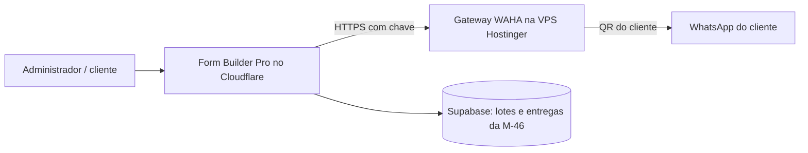

# Estudo M-47 — Criar o grupo e adicionar os inscritos pelo WhatsApp do cliente (QR Code)

Data: 12/11/2026. Origem: pedido do dono depois da entrega da M-46. Este estudo **não é spec nem código**: é a base para decidir se a M-47 entra e como.

## 1. Conclusão em linguagem simples
- **É tecnicamente possível.** Os sistemas que fazem isso conectam o WhatsApp do próprio cliente por QR Code (como o WhatsApp Web) e usam um motor não oficial. O motor que o DeskcommCRM já usa, o WAHA, tem as duas chamadas de que precisamos: criar grupo e adicionar participantes.
- **Não é 100% automático para todo mundo.** Quem restringiu quem pode adicioná-lo a grupos (privacidade do WhatsApp) não é adicionado, mesmo por automação, e mesmo manualmente o WhatsApp mostra "convide por link". Para essas pessoas o link da M-46 continua necessário. **A M-46 não é descartada: vira o plano B da M-47.**
- **O risco é do número do cliente.** Se o WhatsApp restringir o número, quem perde o canal é a assessoria. Seu argumento (pessoas que conhecem o responsável e já esperam o convite) diminui o gatilho mais comum de bloqueio, que é denúncia de spam, mas não o elimina, e eu não consegui comprovar como o WhatsApp detecta esse tipo de uso.
- **Custo adicional provável: zero**, usando a sua VPS Hostinger (2 vCPU, 8 GB, paga até 28/05/2027).
- **Recomendação:** não construir ainda. Fazer primeiro uma **prova de conceito de 1 a 2 dias, com um número de teste (nunca o do cliente)**, e só então decidir.

## 2. O que o DeskcommCRM tem e não tem (verificado no repositório, commit `df392a7`, 01/11/2026)
- Usa **WAHA com motor NOWEB**, conexão por QR, com "anti-ban": intervalo entre mensagens (`throttle`), variação aleatória (`jitter`), janela de horário, teto diário e "aquecimento" por idade do número (`lib/automation/throttle.ts`, `components/connections/AntiBanSheet.tsx`, `hooks/channels/usePacingKnobs.ts`).
- **Não tem criação de grupo nem adição de participantes.** O cliente WAHA dele (`lib/waha/client.ts`) só **lista** grupos (`listarGrupos`). Ou seja, a proteção que ele traz é para **mensagens**; para adicionar membros teríamos de escrever a chamada e o ritmo próprios, usando o DeskcommCRM só como referência (conexão por QR, saúde da sessão, reconexão). Não li a lógica do `throttle.ts` a fundo.
- Licença do DeskcommCRM: MIT. Runbook de produção: WAHA em VPS, ~150 MB por sessão no motor NOWEB.

## 3. O que o WAHA oferece (documentação oficial)
- Criar grupo: `POST /api/{sessão}/groups` com `name` e lista `participants` (`5511999999999@c.us`).
- Adicionar: `POST /api/{sessão}/groups/{id}/participants/add`.
- Ambos documentados nos motores WEBJS, WPP, NOWEB e GOWS. Quem cria o grupo é o próprio número conectado, então **o cliente já nasce administrador**.
- Documentação do Baileys (motor por baixo do NOWEB): `groupParticipantsUpdate` devolve **um resultado por participante**: 200 adicionado, 403 recusado (em geral privacidade), 404 não encontrado, 408 tempo esgotado, 409 já está no grupo. Para 403 ele não descreve convite automático: o **fallback é nosso** (link da M-46).
- WAHA se descreve como "uma instância real do WhatsApp Web" e avisa: o WhatsApp **não permite bots nem clientes não oficiais**, então não deve ser considerado totalmente seguro.
- **Custo do WAHA:** o runbook do DeskcommCRM diz "WAHA Plus, ~US$ 30 por mês". A página oficial atual diz que, desde a versão 2026.6.1, **tudo o que era do Plus passou para o Core, gratuito e aberto**. Conferir antes de contar o custo.

## 4. Riscos (nesta ordem)
1. **Bloqueio ou restrição do número do cliente** (perde-se o canal de avisos e o contato com a base). Os Termos do WhatsApp permitem suspender contas que violem as regras, e as diretrizes proíbem "mensagens em massa, automáticas ou automação para prejudicar o WhatsApp ou os usuários" e contato indesejado repetido. O texto que consegui ler **não proíbe expressamente** cliente não oficial nem adição em grupo; a aplicação real é decisão da Meta. Parecer jurídico: pendente do advogado.
2. **Quem recusa (403):** privacidade de grupos do inscrito. Tratado pelo link da M-46.
3. **Credencial muito sensível:** a sessão guardada na VPS dá acesso total ao WhatsApp do cliente (conversas, contatos). Exige VPS endurecida, acesso por chave, API do WAHA fechada (só o Worker chama), backup criptografado e a opção de o cliente desconectar quando quiser.
4. **Operação:** o cliente precisa manter o celular com internet; o aparelho vinculado pode ser desconectado depois de dias sem o telefone (regra que lembro mas **não verifiquei**). Precisa de tela de saúde e de reconexão.
5. **LGPD:** os membros veem o número uns dos outros. Para quem se inscrever daqui para frente, a ciência no formulário (RF-25) deve dizer que **a pessoa será adicionada** ao grupo; para os 57 atuais, o texto do convite informa. Base legal e texto: advogado.
6. **Dependência de um projeto não oficial:** o motor pode quebrar quando o WhatsApp muda; por isso a funcionalidade fica **opcional**, atrás de chave, com o convite por link sempre disponível.

## 5. Como encaixar sem quebrar o que já decidimos

- **Fica fora do Worker**: o motor precisa de conexão contínua, que o Cloudflare Workers não mantém. Roda na VPS, em contêiner, como no DeskcommCRM.
- **Reaproveita a M-46:** mesmas tabelas `invite_batches`/`invite_deliveries` (canal novo `group_add`), mesmo painel, mesmos limites e a mesma autorização do link do cliente (T-44).
- **ADR novo (ADR-006):** emenda o ADR-001 e a regra ARQ-01 ("nenhuma biblioteca ou API do WhatsApp **no Worker**; qualquer integração só por gateway isolado, com chave de ligar/desligar").
- **Fluxo:** (1) cliente toca em "Conectar meu WhatsApp" e lê o QR; (2) "Criar grupo do evento" com nome sugerido; (3) o sistema adiciona em ritmo lento, em segundo plano, com progresso; (4) quem der 403 vira "enviar convite por link" (M-46); (5) no fim o cliente pode "Desconectar WhatsApp".
- **Ritmo (hipótese a testar, não validada):** adicionar um a um, com intervalo aleatório (por exemplo 20 a 60 s), em horário comercial: 57 pessoas levariam cerca de 20 a 60 minutos, em segundo plano. Só enviar convite/aviso pelo grupo depois, de forma manual pelo cliente.

## 6. Prova de conceito proposta (risco primeiro)
Objetivo: responder em 1 a 2 dias, sem tela, **no número de teste**, as perguntas que decidem a M-47.
1. Reinstalar a VPS (Ubuntu atual está para reinstalar) e subir o WAHA em contêiner, API fechada.
2. Conectar um **chip de teste** por QR; criar grupo com 1 pessoa; adicionar 5 a 10 números de teste (amigos que topem), incluindo 2 com privacidade "somente meus contatos".
3. Registrar por participante: 200, 403, 409, tempo gasto, e se o número "salvo na agenda" muda o resultado.
4. Observar 48 h: sessão estável? reconexão? alguma restrição no chip de teste?
5. Medir RAM/CPU de uma sessão.
Critério de decisão: se 403 for raro entre os inscritos reais, se a sessão ficar estável e o chip de teste não sofrer restrição, a M-47 avança para PRD/spec; caso contrário fica só a M-46.
**Passos seus (🧑):** um chip/número descartável, 5 a 10 pessoas de teste, reinstalar a VPS, e decidir se quer que eu prepare o prompt da prova de conceito.

## 7. Decisões pendentes
1. Seguir com a prova de conceito? (Recomendado.)
2. O cliente aceita por escrito o risco ao número dele? Texto do advogado.
3. Manter a M-46 em andamento como plano B (recomendado: sim, ela serve de base e de fallback).
4. Conferir o custo real do WAHA (Core gratuito x Plus).

## 8. Não verificado
Regras de detecção do WhatsApp para adições em massa; ritmo "seguro"; se contato salvo influencia; regra de desconexão por inatividade do celular; licença exata do WAHA Core; se o WAHA devolve resultado por participante como o Baileys; leitura profunda do `throttle.ts`.

## Fontes
- DeskcommCRM (repositório do dono, commit `df392a7`): `README.en.md`, `lib/waha/client.ts`, `docs/runbooks/waha-hostgator.md`
- [WAHA, grupos](https://waha.devlike.pro/docs/how-to/groups) · [WAHA, motores](https://waha.devlike.pro/docs/how-to/engines) · [WAHA, grupos e aviso de risco](https://waha.devlike.pro/whatsapp-groups/) · [WAHA Plus/Core](https://waha.devlike.pro/docs/how-to/waha-plus/)
- [Baileys, participantes](https://www.mintlify.com/WhiskeySockets/Baileys/groups/participants) · [Baileys, grupos](https://baileys.wiki/features/groups)
- [Whapi, por que participantes não são adicionados](https://support.whapi.cloud/help-desk/faq/why-arent-participants-being-added-to-the-group) (fonte de fornecedor)
- [Termos do WhatsApp (EEA)](https://www.whatsapp.com/legal/terms-of-service-eea) · [Diretrizes de mensagens](https://www.whatsapp.com/legal/messaging-guidelines?lang=en)
