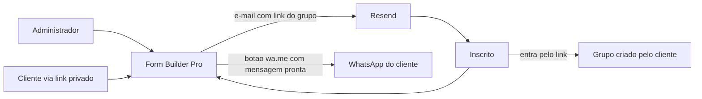

# PRD — M-46 Convite em lote para o grupo do WhatsApp (Form Builder Pro)

Modo: sobre base existente (código próprio, Form Builder Pro em produção, `main` = 524ac2b). Stack e arquitetura são herdadas; este PRD só acrescenta a feature.
Data: 12/11/2026. Autor: Claude, com decisões do dono (Thiago Miranda, Tríade).

## 1. Contexto e problema

A cada evento, a assessoria de corrida (cliente) cria um grupo de WhatsApp e coloca os inscritos nele para passar as informações da corrida durante a semana. Com 57 inscritos no formulário atual, isso significa salvar 57 contatos na agenda ou procurar os já salvos, criar o grupo e adicionar um a um. O dono pediu, com prioridade máxima, que o sistema faça isso automaticamente, tanto no painel do administrador quanto no link privado do cliente (protegido por código desde a T-44).

**Achado que muda o escopo: adicionar 57 pessoas direto a um grupo, de forma automática e legítima, não é possível hoje.** O que a pesquisa (fontes na seção 13) mostrou:

- A API oficial de grupos da Meta (Groups API) não permite adicionar participantes. O sistema gera um link de convite e a pessoa entra por conta própria. Além disso, o grupo da API tem no máximo 8 participantes e só vale para conta comercial com status de Official Business Account (OBA), que verificação de negócio e plano pago não garantem. Inviável para 57 pessoas.
- Bibliotecas não oficiais (Baileys, whatsapp-web.js e similares) conseguem adicionar pessoas, mas violam os termos do WhatsApp, podem levar à suspensão permanente do número (que, para o cliente, é o canal de relacionamento real) e exigem um processo sempre ligado, o que não roda em Cloudflare Workers.
- Mesmo adicionando manualmente, a configuração de privacidade do WhatsApp "Grupos" (padrão "Todos"; opções "Meus contatos" e "Meus contatos, exceto") impede a adição de quem escolheu restringir, e só o link de convite funciona nesse caso.
- Num grupo comum, todos os participantes enxergam os números uns dos outros. Colocar 57 pessoas sem elas pedirem expõe telefones entre inscritos (LGPD, finalidade e minimização).

Conclusão de produto: o ganho que o cliente quer (não perder tempo montando o grupo) se obtém com **convite por link**, que a própria pessoa aceita. O sistema faz todo o trabalho de distribuir o convite; o cliente cria o grupo uma única vez no WhatsApp e cola o link.

## 2. Objetivo e métricas de sucesso

Reduzir o trabalho do cliente por evento, de montar o grupo contato a contato para: criar o grupo uma vez, colar o link, clicar em um botão.

| Métrica | Hoje | Meta |
|---|---|---|
| Tempo do cliente para convidar 57 inscritos | dezenas de minutos (manual) | menos de 2 minutos de ação do cliente |
| Contatos salvos na agenda do cliente | 57 | 0 |
| Risco ao número do WhatsApp do cliente | baixo (manual) | nenhum aumento (só convite por link, sem automação do WhatsApp) |
| Custo adicional | zero | zero (dentro do plano gratuito do Resend, ver RNF-03) |

## 3. Personas

- **Administrador (Thiago):** configura o formulário, gera o link privado do cliente, resolve exceções.
- **Cliente (assessoria):** acessa o link privado com código de acesso; quer avisar os inscritos e manter o grupo da semana. Pouca familiaridade técnica.
- **Inscrito (atleta):** recebe o convite, entra no grupo se quiser, sem ter o número exposto antes de aceitar.

## 4. Escopo

### Dentro (MVP)
- Campo "Link do grupo do WhatsApp" por formulário.
- Link do grupo na tela de confirmação e no e-mail de confirmação de novas inscrições.
- Envio do convite por e-mail, em lote, para quem já se inscreveu, com um clique.
- Lista "Convidar pelo WhatsApp": botão por inscrito que abre o WhatsApp com a mensagem pronta (sem salvar o contato).
- Download dos contatos em arquivo .vcf (para quem preferir adicionar manualmente).
- Mesmas funções no link privado do cliente, sujeitas à sessão do código de acesso.

### Fora (e por quê)
- Adicionar pessoas ao grupo automaticamente por API oficial: inviável (8 participantes, OBA, só convite).
- Adicionar pessoas por biblioteca não oficial: viola os termos, risco de banimento do número do cliente, exige servidor persistente, e não funciona para quem restringiu quem pode adicioná-lo.
- Criar o grupo pelo sistema: o WhatsApp não oferece isso para grupos comuns sem o caminho acima.
- Saber quem entrou no grupo: o WhatsApp não informa ao sistema.
- Canal do WhatsApp (transmissão de mão única): fica como alternativa para o cliente, sem desenvolvimento. Ver DP-04.

## 5. Requisitos funcionais

Prioridade por MoSCoW. Todos os critérios são testáveis.

**RF-01 — Link do grupo no formulário (Must).** Como administrador, quero informar o link do grupo do WhatsApp do evento, para que o sistema o distribua.
Critério: Dado um formulário, quando informo `https://chat.whatsapp.com/<código>`, então o link é salvo; link com outro domínio ou formato é recusado com mensagem clara; campo vazio é permitido.

**RF-02 — Link na confirmação (Must).** Como inscrito, quero receber o link do grupo ao me inscrever, para entrar se eu quiser.
Critério: Dado um formulário com link do grupo, quando uma inscrição é concluída, então a tela de confirmação e o e-mail de confirmação mostram um botão/link "Entrar no grupo de avisos do evento"; sem link configurado, nada muda.

**RF-03 — Convite por e-mail em lote (Must).** Como administrador ou cliente, quero enviar o convite do grupo a todos os inscritos com um clique, para não precisar chamar um por um.
Critério: Dado um formulário com link do grupo e N inscritos com e-mail válido, quando clico em "Enviar convite por e-mail" e confirmo o resumo (quantidade de destinatários), então cada inscrito recebe um e-mail com o link e a ação é registrada (quem, quando, quantos). Quem já recebeu não recebe de novo, salvo ação explícita "reenviar".

**RF-04 — Lista Convidar pelo WhatsApp (Must).** Como cliente, quero um botão por inscrito que abre o WhatsApp dele com a mensagem pronta, para convidar quem não leu o e-mail sem salvar contato.
Critério: Dado um inscrito com WhatsApp válido, quando clico em "Convidar", então abre `https://wa.me/55<DDD+número>?text=<mensagem com o link>`; a mensagem padrão é editável antes do envio e inscritos sem WhatsApp válido aparecem sem botão.

**RF-05 — Marcar convite enviado (Should).** Como cliente, quero ver quem já foi convidado (por e-mail ou pelo botão do WhatsApp), para não repetir.
Critério: Dado que cliquei em "Convidar" ou o e-mail foi enviado, então a linha mostra "Convidado em <data>" e o filtro "Ainda não convidados" funciona.

**RF-06 — Baixar contatos em .vcf (Should).** Como cliente, quero baixar os contatos dos inscritos num arquivo para importar na agenda de uma vez, caso prefira adicionar manualmente.
Critério: Dado N inscritos com WhatsApp válido, quando clico em "Baixar contatos (.vcf)", então baixo um arquivo com N contatos (nome e telefone com +55), e o arquivo abre em Android e iPhone.

**RF-07 — Mesmas funções no link do cliente (Must).** Como cliente, quero usar RF-03 a RF-06 pelo meu link protegido.
Critério: Dado link com código de acesso e sessão válida, então as funções estão disponíveis; sem sessão válida, nenhuma é acessível (a tela "Link protegido" continua).

**RF-08 — Cliente define o link do grupo (Should).** Como cliente, quero colar eu mesmo o link do grupo no meu painel, sem depender do administrador.
Critério: Dado sessão válida, quando o cliente cola um link válido, então o campo do RF-01 é atualizado; a alteração fica registrada com data. Exige gravação por sessão do link privado (ver CA-05 e segurança).

**RF-09 — Texto de ciência no formulário (Should).** Como inscrito, quero saber que receberei o convite do grupo, antes de me inscrever.
Critério: Dado link do grupo ativo, então o formulário mostra uma frase informativa de que o convite será enviado por e-mail e que a entrada é opcional.

## 6. Requisitos não funcionais

| ID | Requisito | Critério verificável | Pendência |
|---|---|---|---|
| RNF-01 | Nenhuma automação do WhatsApp do cliente | O código não importa nem chama bibliotecas não oficiais nem a Groups API; verificável por inspeção de dependências (diff vazio de dependências de WhatsApp) | — |
| RNF-02 | Privacidade | Convites por e-mail não mostram a lista de outros inscritos nem seus telefones; o .vcf só é gerado após sessão válida | — |
| RNF-03 | Custo zero | O envio em lote respeita o limite do plano gratuito do Resend; o sistema bloqueia envios acima do limite e avisa | **[definir]** conferir limite diário e mensal vigente do plano do Resend do projeto (referência: 100 e-mails por dia) |
| RNF-04 | Abuso | No máximo 1 envio em lote por formulário a cada 10 minutos e teto diário por formulário; tentativas além disso são recusadas | **[definir]** valores finais na arquitetura |
| RNF-05 | Rastreabilidade | Cada envio em lote registra autor (administrador ou "cliente via link"), data, destinatários e resultado | — |
| RNF-06 | LGPD | Finalidade registrada: informar sobre o evento em que a pessoa se inscreveu; o e-mail traz motivo do contato e forma de dizer que não quer mais mensagens | **[definir]** texto jurídico final (orientação do advogado) |
| RNF-07 | Desempenho | Enviar convite para 57 inscritos conclui em até 60 segundos e a tela mostra progresso | **[definir]** confirmar na arquitetura |
| RNF-08 | Compatibilidade do link wa.me | Telefones normalizados para o formato internacional; botão funciona em celular e computador | — |

## 7. Direção arquitetural (herdada)

Sem mudança de padrão. A feature é um módulo a mais dentro do monolito atual (TanStack Start em Cloudflare Workers, Supabase, Resend). Não entra servidor novo, fila externa nem serviço pago. O envio em lote precisa ser dividido em lotes pequenos para caber no limite de tempo e de chamadas do Worker (candidata CA-03). Diagrama de contexto:

O WhatsApp aparece só como destino de links; o sistema não se conecta a ele.

## 8. Stack

Herdada, sem nova biblioteca prevista. Geração do .vcf feita no código (texto padronizado vCard 3.0). Nenhuma dependência nova (diff de dependências esperado: vazio).

## 9. Modelo de dados (visão geral)

- Formulário ganha o campo `whatsapp_group_link` (texto, opcional).
- Nova entidade "convite enviado": formulário, inscrição, canal (e-mail ou WhatsApp), data, autor, resultado. Permite RF-03 sem duplicar envio e RF-05.
- Nova entidade "lote de convites" (envio em massa): formulário, autor, data, total, enviados, falhas. Permite RNF-04 e RNF-05.

Detalhes de chaves, índices e RLS ficam para a SDD.

## 10. Riscos e premissas

| Risco / premissa | Efeito | Tratamento |
|---|---|---|
| Cliente espera "entrar automaticamente sem fazer nada" | Frustração com o convite por link | Alinhar a expectativa antes (DP-01); o ganho é tempo, não eliminação do aceite do inscrito |
| Parte dos inscritos não abre o e-mail | Menos adesão | RF-04 (botão do WhatsApp) cobre quem não leu o e-mail |
| E-mails caindo em spam | Convite não chega | Remetente já usado nas confirmações; texto curto; conferir domínio e SPF/DKIM no Resend |
| Link do grupo vaza | Estranhos entram | Cliente pode redefinir o link no WhatsApp; grupo com aprovação de entrada ativável pelo cliente |
| Cliente usa o botão em massa como spam | Reputação do domínio e do Resend | RNF-04 (limites) e registro de autoria |
| Telefones do formulário sem 55/DDD válido | Botões desabilitados | Validador já existe (T-24d); lista mostra quem ficou de fora |
| Premissa: formulário tem campo de e-mail | Sem e-mail, RF-03 não funciona | RF-04 e RF-06 continuam servindo; avisar na tela |

## 11. Roadmap

- **M-46 fase 1 (urgente):** RF-01, RF-02, RF-03, RF-04, RF-07.
- **M-46 fase 2:** RF-05, RF-06, RF-08, RF-09.
- **Depois, só com demanda real:** avaliar WhatsApp Business Platform paga com templates para avisos (mensagem 1:1 por inscrito, com opt-in), caso o cliente queira envio direto pelo WhatsApp sem e-mail. Fora do escopo agora.

## 12. Decisões

### Decisões de produto

| ID | Decisão | Por quê | Quem decidiu | Pendência |
|---|---|---|---|---|
| DP-01 | Convite por link, não adição automática | A adição automática é inviável pela via oficial e arriscada pela não oficial; o convite protege o número do cliente e respeita a vontade do inscrito | Proposta do Claude | **Aguarda aprovação do dono e alinhamento com o cliente** |
| DP-02 | O grupo é criado pelo cliente no próprio WhatsApp; o sistema só distribui o link | O WhatsApp não oferece criação de grupo comum por sistema legítimo | Proposta do Claude | Aguarda aprovação |
| DP-03 | O e-mail em lote é o canal principal do convite; o botão wa.me é reforço | E-mail é gratuito, automático e não expõe telefone | Proposta do Claude | Aguarda aprovação |
| DP-04 | Cliente pode optar por Canal do WhatsApp (só leitura) em vez de grupo quando só precisar avisar | No Canal os seguidores não veem os números uns dos outros e não há limite de 1.024 | Proposta do Claude | Perguntar ao cliente se os inscritos precisam conversar no grupo |

### Decisões técnicas candidatas a ADR

| ID | Candidata | Contexto |
|---|---|---|
| CA-01 | Não usar a Groups API oficial | Limite de 8 participantes, exige OBA e só aceita convite |
| CA-02 | Não usar bibliotecas não oficiais do WhatsApp | Violam os termos, risco de banimento, exigem processo persistente |
| CA-03 | Envio em lote por e-mail em fatias pequenas, com registro de cada fatia e retomada em caso de falha | Limites de tempo e chamadas do Worker; limite do plano do Resend |
| CA-04 | Persistir convites enviados e lotes em tabelas próprias | RF-03, RF-05, RNF-04, RNF-05 |
| CA-05 | Gravação via link privado (cliente define o link, dispara lote) usando a sessão assinada da T-44 | Hoje o link do cliente é só leitura; passa a ter ações de escrita, o que amplia a superfície de ataque (ver segurança) |

## 13. Fontes (consultadas em 12/11/2026)

- [Meta for Developers, Groups API (documentação)](https://developers.facebook.com/documentation/business-messaging/whatsapp/groups/reference): grupos criados com link de convite; não é possível adicionar participantes manualmente.
- [Kapso, estado da Groups API em 2026](https://kapso.com/blog/whatsapp-groups-api-state-2026): exige Official Business Account, máximo de 8 participantes por grupo, entrada só por convite, cobrança por destinatário. Fonte de terceiros; confirmar na documentação da Meta antes de qualquer decisão futura.
- [Periskope, requisitos e limites da Groups API](https://periskope.app/blog/whatsapp-groups-api-requirements-eligibility-limits): números do app WhatsApp Business e modo Coexistence não são elegíveis. Fornecedor, com interesse comercial.
- [Zylos Research, WhatsApp API and Automation 2026 (26/01/2026)](https://zylos.ai/research/2026-01-26-whatsapp-api-automation): bibliotecas não oficiais violam os termos e podem causar suspensão e banimento permanente. Interpretação do autor, não texto dos termos.
- [Canaltech, como impedir que te coloquem em grupos (10/08/2022)](https://canaltech.com.br/apps/como-impedir-que-te-coloquem-em-grupos-de-whatsapp-sem-permissao/): configuração de privacidade de grupos (Todos, Meus contatos, Meus contatos exceto). Matéria de 2022; confirmar o comportamento atual no aplicativo.
- [Canaltech, limite de participantes (28/08/2025)](https://canaltech.com.br/apps/qual-o-limite-para-grupos-do-whatsapp/): limite de 1.024 participantes por grupo, com ressalva de que pode mudar.

Não consegui abrir, nesta sessão, os termos oficiais do WhatsApp nem a página de preços da Meta. A conclusão sobre bibliotecas não oficiais depende de fontes secundárias.

## 14. Perguntas em aberto

1. O cliente precisa que os inscritos conversem no grupo, ou só receba avisos (nesse caso, o Canal serve)?
2. Todos os formulários do cliente têm campo de e-mail? (RF-03 depende disso.)
3. O plano do Resend em uso permite quantos e-mails por dia hoje?
4. Aprovação do dono para o convite por link como substituto da adição automática (DP-01).
